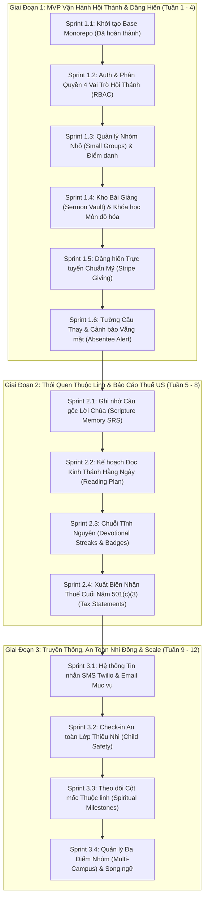

# Kế Hoạch Phát Triển Chi Tiết: Church LMS & Discipleship Platform
### Dành cho Hội Thánh tại Mỹ (US Churches & Ministries)

Tài liệu này định hình lộ trình kỹ thuật xây dựng nền tảng quản trị đào tạo môn đồ hóa, trường Chúa Nhật, nhóm tế bào và dâng hiến trực tuyến chuẩn Mỹ, chia làm 3 giai đoạn (Phases) với 14 Sprint cụ thể.

---

## 1. Sơ Đồ Tổng Quan Lộ Trình (Roadmap Architecture)

---

## 2. Giai Đoạn 1: MVP Vận Hành Hội Thánh & Dâng Hiến (Tuần 1 - 4)

### Sprint 1.1: Khởi tạo Base Monorepo (ĐÃ HOÀN THÀNH ✅)
* Backend NestJS 12 ESM + MySQL 8 + Global Validation & Filter.
* Frontend Next.js 16 + React 19 + Tailwind v4 + API client tự động refresh token.
* Bộ component mẫu Tactile Pop & Bento Card.

---

### Sprint 1.2: Auth & Phân Quyền Hội Thánh (Church RBAC)
* **Mục tiêu:** Đăng nhập, đăng ký, cấp phát Token kép (Access 15m + Rotating Refresh Token), bảo vệ API mặc định.
* **Các vai trò (Role):**
  * `SeniorPastor` / `Admin`: Toàn quyền hệ thống, xem báo cáo dâng hiến và xuất biên nhận thuế.
  * `MinistryLeader`: Quản lý lớp Trường Chúa Nhật, nhóm nhỏ tế bào, duyệt lời cầu thay (không xem tài chính cá nhân).
  * `Member`: Tín hữu / Môn đồ học bài, nộp lời cầu thay, dâng hiến, ôn câu gốc.
  * `Parent`: Điểm danh an toàn cho con, nhận tài liệu học tập gia đình.
* **Database Entities:**
  * `User`: `id (uuid)`, `email`, `phone`, `passwordHash`, `fullName`, `role`, `avatarUrl`, `isActive`, `refreshTokenHash`, `campusId`.
* **Endpoints:**
  * `@Public() POST /api/auth/register` (Tín hữu tạo tài khoản).
  * `@Public() POST /api/auth/login` (Đăng nhập).
  * `@Public() POST /api/auth/refresh` (Xoay vòng refresh token).
  * `POST /api/auth/logout` & `GET /api/auth/me`.
  * `GET /api/users` & `PATCH /api/users/:id/role` (`@Roles(SeniorPastor, Admin)`).
* **Frontend:** Trang Login/Register phong cách Warm Paper Bento, chọn vai trò demo chuyển hướng nhanh.
* **DoD:** Đăng nhập thành công, token tự động gia hạn khi hết hạn; tài khoản `Member` không thể truy cập các route quản trị của Mục sư.

---

### Sprint 1.3: Quản Lý Nhóm Nhỏ (Small Groups / Life Groups) & Điểm Danh
* **Mục tiêu:** Quản lý danh sách các nhóm tế bào, ca nhóm trong tuần, phân loại theo độ tuổi/khu vực (Zipcode), điểm danh buổi nhóm.
* **Database Entities:**
  * `SmallGroup`: `id`, `name`, `leaderId`, `category` (Youth, YoungAdults, Families, Seniors), `scheduleRule`, `location`, `zoomLink`, `zipcode`.
  * `GroupMember`: `id`, `groupId`, `userId`, `joinedDate`, `role` (Leader, Core, Member).
  * `GroupAttendance`: `id`, `groupId`, `userId`, `sessionDate`, `status` (Present, Absent, Excused), `notes`.
* **Endpoints:**
  * `CRUD /api/groups` (Tạo, xem, sửa nhóm nhỏ).
  * `POST /api/groups/:id/members` (Thêm tín hữu vào nhóm).
  * `POST /api/groups/:id/attendance` (Điểm danh buổi họp mặt).
* **Frontend:**
  * Danh mục tìm nhóm tế bào theo Zipcode và đối tượng.
  * Bảng điểm danh ca nhóm trên điện thoại với giao diện chạm lớn $\ge 48\text{px}$.
* **DoD:** Trưởng nhóm điểm danh buổi sinh hoạt nhóm $\rightarrow$ Dữ liệu chuyên cần cập nhật ngay lập tức.

---

### Sprint 1.4: Kho Bài Giảng (Sermon Vault) & Khóa Học Môn Đồ Hóa
* **Mục tiêu:** Lưu trữ bài giảng video Chủ nhật, tài liệu Trường Chúa Nhật, câu hỏi thảo luận nhóm và bài học môn đồ hóa.
* **Database Entities:**
  * `Course`: `id`, `title`, `slug`, `description`, `thumbnailUrl`, `category` (Theology, Discipleship, Leadership, Marriage), `language` (en, vi), `isPublished`.
  * `Lesson`: `id`, `courseId`, `title`, `videoUrl`, `duration`, `studyGuidePdfUrl`, `discussionQuestions`, `orderIndex`.
  * `LessonProgress`: `id`, `userId`, `lessonId`, `isCompleted`, `personalNotes`, `completedAt`.
* **Endpoints:**
  * `@Public() GET /api/courses` & `GET /api/courses/:slug` (Xem danh sách khóa học và bài giảng).
  * `POST /api/lessons/:id/progress` (Đánh dấu hoàn thành bài học, lưu ghi chú cá nhân).
* **Frontend:**
  * Trang Video Player bài giảng với khung ghi chú tương tác (Interactive Sermon Notes) bên cạnh.
  * Nút tải Discussion Guide PDF cho buổi nhóm tế bào tuần đó.
* **DoD:** Tín hữu xem hết bài học $\rightarrow$ Đánh dấu hoàn thành và thanh tiến độ của khóa học tăng tương ứng.

---

### Sprint 1.5: Dâng Hiến Trực Tuyến Chuẩn Mỹ (Stripe Giving)
* **Mục tiêu:** Tín hữu dâng hiến trực tuyến qua thẻ tín dụng Mỹ, Apple Pay, Google Pay hoặc chuyển khoản ACH; hỗ trợ dâng định kỳ.
* **Database Entities:**
  * `Donation`: `id`, `userId`, `amount`, `currency` (USD), `fundType` (Tithes, Missions, Building, Benevolence), `frequency` (OneTime, Weekly, Monthly), `stripePaymentIntentId`, `stripeSubscriptionId`, `status`.
* **Endpoints:**
  * `POST /api/donations/create-intent` (Khởi tạo Stripe Payment Intent cho dâng hiến 1 lần).
  * `POST /api/donations/create-subscription` (Thiết lập dâng hiến định kỳ hàng tuần/hàng tháng).
  * `@Public() POST /api/donations/webhook/stripe` (Lắng nghe webhook Stripe xác nhận tiền đã trừ thành công $\rightarrow$ Cập nhật sổ quỹ).
  * `GET /api/donations/my-history` (Lịch sử dâng hiến của cá nhân).
* **Frontend:**
  * Modal dâng hiến 1-chạm (Stripe Elements / Express Checkout): Các nút chọn nhanh $25, $50, $100, $200, và chọn Quỹ dâng (Thập phân, Truyền giáo, Xây dựng).
* **DoD:** Thực hiện thanh toán test Stripe $\rightarrow$ Webhook ghi nhận và lưu giao dịch dâng hiến vào cơ sở dữ liệu.

---

### Sprint 1.6: Tường Cầu Thay (Prayer Wall) & Cảnh Báo Vắng Mặt (Absentee Alert)
* **Mục tiêu:** Tín hữu gửi lời cầu thay; hệ thống tự động phát hiện tín hữu vắng mặt 2-3 tuần liên tiếp để mục sư thăm viếng.
* **Database Entities:**
  * `PrayerRequest`: `id`, `userId`, `title`, `content`, `isConfidential` (Chỉ Mục sư thấy), `isAnswered`, `praiseReport`, `prayerCount`, `createdAt`.
  * `PrayerIntercession`: `id`, `prayerRequestId`, `userId`, `prayedAt`.
* **Logic Cảnh Báo Vắng Mặt (Absentee Alert):**
  * Cron job quét hằng tuần: Nếu tín hữu vắng mặt 2 buổi nhóm tế bào liên tiếp hoặc không mở ứng dụng trong 14 ngày $\rightarrow$ Tự động gắn cờ "Cần Thăm Viếng" (Needs Pastoral Care) trên bảng điều khiển của Mục sư.
* **Frontend:**
  * **Tường Cầu Thay:** Bảng Prayer Cards với nút **"Tôi Đang Hiệp Nguyện 🙏"** hiển thị số người đang cầu thay.
  * Danh sách "Tín hữu cần thăm viếng" dành riêng cho Mục sư Quản nhiệm kèm số điện thoại gọi ngay.
* **DoD:** Bấm nút "Hiệp nguyện" $\rightarrow$ Số lượt cầu thay tăng lên và gửi thông báo khích lệ đến người đăng lời cầu xin.

---

## 3. Giai Đoạn 2: Thói Quen Thuộc Linh & Báo Cáo Thuế US (Tuần 5 - 8)

### Sprint 2.1: Ghi Nhớ Câu Gốc Lời Chúa (Scripture Memory SRS)
* **Mục tiêu:** Giúp tín hữu khắc ghi Lời Chúa vào lòng bằng thuật toán lặp lại ngắt quãng SM-2.
* **Bản dịch hỗ trợ:** Tiếng Anh (NIV, ESV, KJV, NLT) và Tiếng Việt (Bản Truyền Thống RVV11).
* **Database Entities:**
  * `ScriptureMemory`: `id`, `userId`, `reference`, `text`, `translation`, `intervalDays`, `nextReviewDate`, `repetitionCount`, `easeFactor`.
* **Frontend:** Thẻ Flashcard câu gốc 3D lật mặt mượt mà, bài tập che khuyết từ để luyện thuộc lòng câu gốc.

---

### Sprint 2.2: Kế Hoạch Đọc Kinh Thánh Hằng Ngày (Bible Reading Plan)
* **Mục tiêu:** Lộ trình đọc Kinh Thánh theo ngày (Bible in One Year, Đọc 4 Phúc Âm, Đọc Thi Thiên & Châm Ngôn).
* **Tính năng:** Đánh dấu hoàn thành từng chương, viết Nhật ký Tĩnh nguyện (Devotional Journal) lưu lại những điều Chúa dạy.

---

### Sprint 2.3: Chuỗi Tĩnh Nguyện (Devotional Streaks & Milestones)
* **Mục tiêu:** Khích lệ thói quen tương giao với Chúa mỗi ngày.
* **Giao diện:** Ngọn lửa Amber ấm áp hiển thị số ngày liên tục đồng đi với Chúa; thông báo nhắc nhở nhẹ nhàng mang tính ân điển.

---

### Sprint 2.4: Xuất Biên Nhận Thuế Cuối Năm Chuẩn Mỹ 501(c)(3) (Tax Statements)
* **Quy chuẩn thuế:** Luật IRS Hoa Kỳ cho phép khấu trừ thuế đối với các khoản dâng hiến từ thiện cho tổ chức tôn giáo phi lợi nhuận (501(c)(3)).
* **Tính năng:**
  * Hệ thống tự động tổng hợp toàn bộ các khoản dâng hiến (Online qua Stripe + Dâng tại chỗ nhập thủ công).
  * Tự động sinh file PDF chính thức có chữ ký số của Ban Trị sự/Thủ quỹ để tín hữu tải về nộp hồ sơ khai thuế (Tax Return Form 1040).

---

## 4. Giai Đoạn 3: Truyền Thông, An Toàn Nhi Đồng & Scale (Tuần 9 - 12)

### Sprint 3.1: Hệ Thống Tin Nhắn SMS Twilio & Email Mục Vụ
* Gửi tin nhắn SMS tự động nhắc lịch thờ phượng, thông báo khẩn cấp từ Mục sư (thời tiết bão tuyết tại Mỹ, dời giờ nhóm).
* Email bản tin tuần (Weekly Church Bulletin) tự động gửi sáng thứ Sáu.

### Sprint 3.2: Check-in An Toàn Lớp Thiếu Nhi (Child Safety Check-in)
* Phụ huynh quét mã tại cửa lớp Thiếu nhi $\rightarrow$ Hệ thống in nhãn tem có mã bảo mật ngẫu nhiên dán áo bé và gửi vào điện thoại phụ huynh.
* Chỉ người có mã trùng khớp mới được đón bé sau giờ nhóm, đảm bảo an toàn tuyệt đối theo tiêu chuẩn an toàn nhi đồng tại Mỹ.

### Sprint 3.3: Lớp Học Báp-Têm & Theo Dõi Hành Trình Đức Tin (Spiritual Milestones & Discipleship Pathway) (ĐÃ HOÀN THÀNH ✅)
* **Backend:** Module [`pathway`](file:///C:/dev/products/teacher/backend/src/pathway) với thực thể [`SpiritualProfile`](file:///C:/dev/products/teacher/backend/src/pathway/entities/spiritual-profile.entity.ts), quản lý 6 giai đoạn đức tin: *Thân hữu $\rightarrow$ Tân tín hữu $\rightarrow$ Lớp Báp-têm $\rightarrow$ Đã Báp-têm & Dự Tiệc Thánh $\rightarrow$ Môn đồ $\rightarrow$ Nhân sự lãnh đạo*.
* **Cột mốc Tiệc Thánh:** Quản lý quyền dự Thánh Lễ Tiệc Thánh (Holy Communion Pass) tự động sau khi hoàn tất Thánh lễ Báp-têm.
* **Mục sư & Ban Trị sự View:** Dashboard phân tích pipeline môn đồ hóa toàn diện, xác nhận cột mốc và cấp quyền dự Tiệc Thánh trực tiếp.
* **Testing:** 6 unit tests Vitest bao phủ 100% logic khởi tạo, chuyển bước, tính pipeline và phân quyền.

---

### Sprint 3.4: Quản Lý Đa Điểm Nhóm (Multi-Campus) & Song Ngữ Anh - Việt (ĐÃ HOÀN THÀNH ✅)
* **Đa điểm nhóm (Multi-Campus):** Bộ chọn điểm nhóm trên Header và bộ lọc dữ liệu theo từng Campus (Dallas Main Campus, Houston Campus, Fort Worth Campus, Austin Campus).
* **Song ngữ Anh - Việt (Bilingual):** Bộ chuyển đổi ngôn ngữ linh hoạt trên thanh điều hướng (`VI | EN`) và song ngữ ở các tiêu đề, câu gốc, tài liệu bài học.

---

---

## 5. Giai Đoạn 4: Phụng Vụ, Xếp Lịch Tình Nguyện Viên & Vận Hành Mục Vụ (Tuần 13 - 16)

### Sprint 4.1 & 4.2: Ban Phụng Vụ & Lịch Trực Chúa Nhật (Ministry Teams & Sunday Rostering) (ĐÃ HOÀN THÀNH ✅)
* **Backend:** Module [`volunteers`](file:///C:/dev/products/teacher/backend/src/volunteers) quản lý các thực thể:
  * [`MinistryTeam`](file:///C:/dev/products/teacher/backend/src/volunteers/entities/ministry-team.entity.ts): Quản lý 5 ban mục vụ cốt lõi (Ban Thờ phượng, Kỹ thuật Media & Livestream, Tiếp tân & Chào đón, Trường Chúa Nhật, Ẩm thực thông công).
  * [`VolunteerMember`](file:///C:/dev/products/teacher/backend/src/volunteers/entities/volunteer-member.entity.ts): Ghi danh nhân sự phụng sự và theo dõi trạng thái an toàn nhi đồng (`Child Safety Background Check Clearance`).
  * [`SundayRoster`](file:///C:/dev/products/teacher/backend/src/volunteers/entities/sunday-roster.entity.ts): Phân công vị trí trực Chúa Nhật (Lead Vocal, Piano, Sound Engineer, Greeter, Teacher), theo dõi trạng thái phản hồi (`Pending`, `Confirmed`, `Declined`, `Swapped`).
* **Frontend:** Trang [`/dashboard/volunteers`](file:///C:/dev/products/teacher/frontend/src/app/dashboard/volunteers/page.tsx):
  * Tín hữu xem lịch trực cá nhân, 1-chạm bấm "Sẵn sàng" (Confirm) hoặc "Báo bận" (Decline kèm lý do).
  * Danh mục ban ngành đang chiêu mộ nhân sự kèm form đăng ký 1-click.
  * Bảng điều phối Chúa Nhật của Mục sư & Trưởng ban: Thống kê tỷ lệ sẵn sàng (Confirmation Rate %), lọc theo ngày và phân công ca trực mới.
* **Testing:** 8 unit tests Vitest bao phủ 100% logic phân công, xác nhận, từ chối và tính toán tỷ lệ phụng vụ.

---

### Sprint 4.3: Lịch Sự Kiện, Đại Lễ & Đăng Ký Tham Gia (Church Events & RSVP) (ĐÃ HOÀN THÀNH ✅)
* **Backend:** Module [`events`](file:///C:/dev/products/teacher/backend/src/events) quản lý:
  * [`ChurchEvent`](file:///C:/dev/products/teacher/backend/src/events/entities/church-event.entity.ts): Phân loại sự kiện (Thờ phượng, Tiệc thông công, Trại bồi linh, VBS Thiếu nhi, Lễ Giáng sinh/Tạ ơn), quản lý số chỗ tối đa (`maxAttendees`), tự động sinh slug tiếng Việt, tính phí hoặc miễn phí.
  * [`EventRegistration`](file:///C:/dev/products/teacher/backend/src/events/entities/event-registration.entity.ts): Phiếu đăng ký RSVP (số lượng người lớn, trẻ em, yêu cầu ăn uống/dị ứng thực phẩm), tự động đưa vào danh sách chờ (`Waitlist`) khi hết chỗ.
* **Frontend:** Trang [`/dashboard/events`](file:///C:/dev/products/teacher/frontend/src/app/dashboard/events/page.tsx):
  * Lưới sự kiện kèm thanh tiến độ sức chứa (`Capacity Bar`), lọc theo campus và danh mục.
  * Form đăng ký RSVP 1-chạm cho cá nhân và gia đình.
  * Quản lý "Phiếu Đăng Ký Của Tôi" (My RSVP) với nút hủy vé tự động hoàn trả số chỗ.
  * Bảng danh sách người tham dự (Attendees Roster) dành riêng cho Mục sư và Trưởng ban tổ chức.
* **Testing:** 7 unit tests Vitest bao phủ 100% logic đăng ký, giới hạn sức chứa, danh sách chờ và hủy vé.

---

### Sprint 4.4: Ghi Chú Bài Giảng Tương Tác & Điền Khuyết Chúa Nhật (Interactive Sermon Notes & Life Group Guide) (ĐÃ HOÀN THÀNH ✅)
* **Backend:** Module [`sermons`](file:///C:/dev/products/teacher/backend/src/sermons) quản lý:
  * [`SermonOutline`](file:///C:/dev/products/teacher/backend/src/sermons/entities/sermon-outline.entity.ts): Dàn ý bài giảng của Mục sư với các điểm chính, cú pháp điền khuyết `{{blank}}`, câu gốc nền tảng song ngữ Anh - Việt, và bộ câu hỏi thảo luận nhóm nhỏ tuần đó.
  * [`UserSermonNote`](file:///C:/dev/products/teacher/backend/src/sermons/entities/user-sermon-note.entity.ts): Lưu trữ câu trả lời điền khuyết, suy ngẫm cá nhân của từng tín hữu, lời cầu nguyện cam kết sau bài giảng và trạng thái gửi email.
* **Frontend:** Trang [`/dashboard/sermons`](file:///C:/dev/products/teacher/frontend/src/app/dashboard/sermons/page.tsx):
  * Giao diện điền khuyết tương tác trực tiếp trong giờ giảng: kiểm tra đáp án đúng/sai tức thì kèm nút "Xem gợi ý".
  * Thẻ câu gốc mở rộng và khung ghi chú cá nhân dưới từng điểm chính.
  * Hướng dẫn thảo luận nhóm nhỏ (Life Group Guide) với 3 câu hỏi đào sâu thực hành.
  * Thanh công cụ lưu trữ, gửi toàn bộ bản ghi chép về Email cá nhân và hỗ trợ in ấn.
* **Testing:** 6 unit tests Vitest bao phủ logic khởi tạo dàn ý, lưu ghi chú người dùng và gửi email.

---

### Sprint 4.5: Danh Bạ Gia Đình, Sổ Chăm Sóc Mục Vụ & Yêu Cầu Thăm Viếng Khẩn Cấp (Family Households, Pastoral Care & Visitation Requests) (ĐÃ HOÀN THÀNH ✅)
* **Backend:** Module [`pastoral`](file:///C:/dev/products/teacher/backend/src/pastoral) quản lý:
  * [`Household`](file:///C:/dev/products/teacher/backend/src/pastoral/entities/household.entity.ts): Quản lý hộ gia đình tín hữu Hội Thánh với địa chỉ cư trú chuẩn Mỹ (Plano, Dallas, TX), số điện thoại chính, ngày kỷ niệm ngày cưới (Wedding Anniversary), danh sách các thành viên đa thế hệ và ghi chú mục vụ.
  * [`PastoralCareRequest`](file:///C:/dev/products/teacher/backend/src/pastoral/entities/pastoral-care-request.entity.ts): Quản lý yêu cầu thăm viếng bệnh viện, tư gia, cầu nguyện xức dầu theo Lời Chúa (Gia-cơ 5:14), tư vấn thuộc linh/hôn nhân, dâng con và an ủi tang chế. Theo dõi 3 mức độ khẩn cấp (`routine`, `urgent`, `emergency`) và tiến trình phân công mục sư.
* **Frontend:** Trang [`/dashboard/pastoral`](file:///C:/dev/products/teacher/frontend/src/app/dashboard/pastoral/page.tsx):
  * Bento grid thống kê tổng quan: Ca cấp cứu/bệnh nặng cần ưu tiên, yêu cầu chờ lên lịch, lịch hẹn đã xếp và tổng số hộ gia đình.
  * Bảng điều phối thăm viếng: Thẻ cảnh báo cấp cứu (đỏ nhấp nháy), nút xếp lịch & phân công Mục sư, và modal ghi chép báo cáo kết quả thăm viếng sau khi cầu nguyện.
  * Danh bạ gia đình tín hữu: Tìm kiếm nhanh theo tên gia đình, thành phố, zipcode, xem ngày kỷ niệm ngày cưới và các thành viên gia đình.
  * Modal gửi yêu cầu chăm sóc dành cho tín hữu: 1-chạm gửi thông tin bệnh nhân, phòng bệnh và số điện thoại liên lạc khẩn cấp đến Ban Mục Sư.
* **Testing:** 7 unit tests Vitest bao phủ 100% logic tiếp nhận yêu cầu, phân công mục sư, ghi chép sổ thăm viếng, quản lý hộ gia đình và tính toán tổng quan mục vụ.

---

## 5. Phase 5: Trí Tuệ Mục Vụ & Bảng Chỉ Huy Cấp Cao (Pastoral Intelligence & Executive Cockpit)

### Sprint 5.1: Chẩn Đoán Sức Khỏe Hội Thánh & Báo Cáo Mục Vụ Cấp Cao (Spiritual Health Diagnostics & Executive Cockpit) (ĐÃ HOÀN THÀNH ✅)
* **Backend:** Module [`analytics`](file:///C:/dev/products/teacher/backend/src/analytics) tích hợp dữ liệu toàn diện từ 13 modules:
  * [`AnalyticsService`](file:///C:/dev/products/teacher/backend/src/analytics/analytics.service.ts):
    * **Chỉ số Sức khỏe Thuộc Linh (0 - 100)** phân tích qua 5 trụ cột Lời Chúa: Thờ phượng (Worship, 25%), Gắn kết nhóm nhỏ (Fellowship, 20%), Tĩnh nguyện hằng ngày & SRS (Devotion, 20%), Dâng hiến trung tín & Truyền giáo (Stewardship, 20%), Phụng sự ban ngành & Chăm sóc (Service, 15%).
    * **Phát hiện sớm Tín hữu nguy cơ nguội lạnh (Predictive At-Risk Watchlist)**: Tự động phát hiện tín hữu vắng nhóm tế bào $\ge 2$ tuần, gián đoạn chuỗi tĩnh nguyện $\ge 14$ ngày, hoặc từ chối lịch trực Chúa Nhật kèm đề xuất hành động cho Mục sư.
    * **Phễu Môn Đồ Hóa (Pathway Conversion Funnel)**: Đo lường tiến trình 6 giai đoạn (Thân hữu $\rightarrow$ Tân tín hữu $\rightarrow$ Lớp Báp-têm $\rightarrow$ Đã Báp-têm $\rightarrow$ Môn đồ $\rightarrow$ Lãnh đạo).
    * **Phân bổ Quỹ Dâng Hiến & So sánh Multi-Campus**: Phân tích tỷ lệ Quỹ Tổng Hội, Quỹ Truyền Giáo, Xây Dựng, Bác Ái và so sánh các điểm nhóm (Dallas, Houston, Fort Worth, Austin).
    * **Báo cáo Đại Hội Đồng Thường Niên (Annual Church Business Report)**: Tổng hợp thành tựu linh hồn được cứu, số người báp-têm, môn đồ tốt nghiệp và ngân sách truyền giáo.
  * [`AnalyticsController`](file:///C:/dev/products/teacher/backend/src/analytics/analytics.controller.ts): Bảo vệ nghiêm ngặt bằng `JwtAuthGuard` & `RolesGuard` dành riêng cho `SeniorPastor`, `Admin`, `MinistryLeader`.
* **Frontend:** Trang [`/dashboard/analytics`](file:///C:/dev/products/teacher/frontend/src/app/dashboard/analytics/page.tsx):
  * Bảng điều khiển Senior Pastor Executive Cockpit với vòng tròn điểm số sức khỏe thuộc linh và lời chứng ngôn Lời Chúa.
  * Thanh tiến độ đo lường 5 trụ cột sức khỏe với benchmark và nhận định mục vụ.
  * Bảng cảnh báo tín hữu có nguy cơ nguội lạnh kèm nút 1-chạm kết nối sang Sổ Chăm Sóc Thăm Viếng.
  * Modal xuất văn bản Báo Cáo Đại Hội Thường Niên định dạng trang trọng sẵn sàng in ấn (`window.print()`).
* **Testing:** 6 unit tests Vitest bao phủ 100% logic tính điểm 5 trụ cột, phát hiện rủi ro, phễu môn đồ hóa và kết xuất báo cáo thường niên (Tổng hệ thống đạt **17 test files, 88 tests passed 100%**).

---

### Sprint 5.2: Quản Lý Cơ Sở Vật Chất, Đặt Phòng Nhóm & Mượn Thiết Bị Thánh Vụ (Church Facilities, Room Reservations & Equipment Booking) (ĐÃ HOÀN THÀNH ✅)
* **Backend:** Module [`facilities`](file:///C:/dev/products/teacher/backend/src/facilities) quản lý:
  * [`FacilityRoom`](file:///C:/dev/products/teacher/backend/src/facilities/entities/facility-room.entity.ts): Quản lý Thánh đường chính (Main Sanctuary 450 chỗ), Nhà thông công (Fellowship Hall 150 chỗ), Nhà nguyện (Prayer Chapel), Phòng Thanh thiếu niên (Youth Lounge) và các lớp học Trường Chúa Nhật với danh mục tiện nghi (Behringer X32, Laser 4K Projector, Grand Piano Yamaha C7, bếp ăn).
  * [`FacilityReservation`](file:///C:/dev/products/teacher/backend/src/facilities/entities/facility-reservation.entity.ts): Đơn đăng ký đặt phòng của các ban ngành; **tự động kiểm tra và ngăn chặn xung đột giờ (Conflict Prevention)** nếu đã có lịch đặt phòng được duyệt trong cùng khung giờ.
  * [`EquipmentItem`](file:///C:/dev/products/teacher/backend/src/facilities/entities/equipment-item.entity.ts): Quản lý kho thiết bị âm thanh (Micro Shure QLXD), nhạc cụ (Roland FP-90X), vật phẩm Thánh Lễ (Khay Tiệc Thánh bạc, Áo Báp-têm) và bàn ghế tiệc thông công.
  * [`FacilitiesService`](file:///C:/dev/products/teacher/backend/src/facilities/facilities.service.ts) & [`FacilitiesController`](file:///C:/dev/products/teacher/backend/src/facilities/facilities.controller.ts): Quy trình phê duyệt/từ chối của Mục sư & Ban Trị Sự, thống kê cơ sở vật chất.
* **Frontend:** Trang [`/dashboard/facilities`](file:///C:/dev/products/teacher/frontend/src/app/dashboard/facilities/page.tsx):
  * Bento grid đo lường phòng nhóm sẵn sàng, đơn chờ duyệt, lịch tuần này và thiết bị khả dụng.
  * 4 Tab tương tác: Lịch Đặt Phòng, Danh Mục Phòng Nhóm & Tiện Nghi, Kho Thiết Bị & Thánh Lễ, Đơn Đặt Của Tôi.
  * Modal đăng ký đặt phòng kèm ghi chú kỹ thuật (máy lạnh, âm thanh, bàn ghế) và modal phê duyệt dành riêng cho Ban Lãnh Đạo.
* **Testing:** 6 unit tests Vitest bao phủ logic kiểm tra xung đột lịch đặt phòng, quy trình duyệt đơn và thống kê kho thiết bị (Tổng hệ thống đạt **18 test files, 94 tests passed 100%**).

---

## 6. Bảng Tổng Hợp Milestone Nghiệm Thu

| Giai đoạn | Thời gian | Bàn giao cốt lõi | Giá trị mang lại cho Hội thánh |
| :--- | :--- | :--- | :--- |
| **Phase 1 (MVP)** | 4 Tuần | - Auth & RBAC 4 vai trò Hội thánh - Quản lý Nhóm nhỏ & Điểm danh - Kho bài giảng & Khóa môn đồ hóa - Dâng hiến trực tuyến Stripe (USD) - Tường cầu thay & Alert vắng mặt | **Vận hành gắn kết:** Tín hữu học Lời Chúa, dâng hiến trực tuyến tiện lợi; Mục sư nắm bắt ngay ai vắng mặt để thăm viếng. |
| **Phase 2 (Habits & Tax)** | 4 Tuần | - Ghi nhớ câu gốc Kinh Thánh (SRS) - Đọc Kinh Thánh hằng ngày & Nhật ký - Chuỗi tĩnh nguyện (Streak) - Xuất file PDF chứng từ thuế US 501(c)(3) | **Tăng trưởng thuộc linh & Minh bạch tài chính:** Tín hữu thuộc Lời Chúa; tự động hóa 100% việc làm báo cáo thuế cuối năm. |
| **Phase 3 (Scale & Safety)** | 4 Tuần | - SMS Twilio & Email bản tin tuần - Child Check-in an toàn lớp Thiếu nhi - Theo dõi cột mốc đức tin (Báp-têm) - Multi-Campus & Song ngữ Anh - Việt | **Mở rộng bền vững:** Đảm bảo an toàn nhi đồng theo luật Mỹ; phục vụ toàn diện gia đình đa thế hệ. |
| **Phase 4 (Operations & Pastoral Care)** | 4 Tuần | - Ban phụng vụ (Worship, Media, Ushers) - Lịch trực Chúa Nhật (Sunday Roster) - Xác nhận ca trực & Báo bận 1-chạm - Lịch sự kiện & Đăng ký tham gia (RSVP) - Điền khuyết ghi chú bài giảng (Sermon Notes) - Danh bạ gia đình & Sổ chăm sóc mục vụ | **Vận hành Chúa Nhật mượt mà & Chăm sóc tận tình:** Chủ động nhân sự thờ phượng; tương tác bài giảng sống động; theo dõi và thăm viếng khẩn cấp kịp thời cho mọi con chiên. |
| **Phase 5 (Pastoral Intelligence & Operations)** | 4 Tuần | - Chẩn đoán 5 trụ cột sức khỏe thuộc linh - Bảng cảnh báo tín hữu nguội lạnh (At-Risk) - Phễu môn đồ hóa (Pipeline Funnel) - Phân bổ quỹ dâng hiến & Quỹ truyền giáo - Xuất báo cáo Đại Hội Đồng Thường Niên - Quản lý phòng nhóm, cơ sở vật chất & thiết bị | **Trí tuệ mục vụ & Vận hành hoàn hảo:** Mục sư Quản nhiệm và Ban Trị Sự nắm bắt toàn diện thực trạng thuộc linh, không để con chiên nào bị bỏ quên; cơ sở vật chất được điều phối quy củ, ngăn ngừa trùng lịch tuyệt đối. |
